<div align="center">
  
</div>

<h1 align="center">MomozzyCare — Cat Hotel & Boarding</h1>

<p align="center">
  <strong>Website layanan penitipan dan perawatan kucing eksklusif di Sudirman, Jakarta Selatan.</strong><br/>
  Dibangun dengan pendekatan antarmuka <em>mint-emerald</em> yang menenangkan, informatif, dan responsif.
</p>

<p align="center">
  
  
  
  
  
</p>

<p align="center">
  <a href="#ringkasan-proyek">Ringkasan</a> •
  <a href="#fitur--section-utama">Fitur Utama</a> •
  <a href="#alur-pengalaman-pengguna">Alur Pengguna</a> •
  <a href="#sistem-desain">Sistem Desain</a> •
  <a href="#menjalankan-di-lokal">Instalasi</a>
</p>

---

## Ringkasan Proyek

**MomozzyCare** dirancang untuk menjawab kekhawatiran *cat parents* saat harus meninggalkan kucing kesayangan bepergian. Mengusung konsep **1 kamar 1 ekor** dan **nol kontak silang**, platform ini menyajikan transparansi fasilitas kamar, rutinitas perawatan harian, persyaratan kesehatan, serta simulasi estimasi biaya menginap sebelum pengguna melakukan pemesanan via WhatsApp.

---

## Fitur & Section Utama

| Section | Fungsi Utama |
| :--- | :--- |
| **Hero & Quick CTA** | Pengenalan layanan dengan akses langsung ke **Booking via WhatsApp** dan **Hitung Estimasi Biaya**. |
| **Kenapa Kami** | Sorotan protokol **1 kamar 1 ekor**, ruangan bebas kontak silang, dan laporan foto/video harian. |
| **Sehari di Sini** | Linimasa aktivitas harian anabul mulai dari jadwal makan, sesi bermain, sanitasi kandang, hingga pengecekan rutin. |
| **Harga & Estimasi** | Daftar paket menginap per malam dilengkapi kalkulator simulasi biaya berdasarkan durasi menginap. |
| **Syarat & FAQ** | Panduan kriteria kesehatan wajib (bebas kutu/jamur, sehat klinis, vaksin) serta tanya-jawab seputar penitipan. |
| **Floating WhatsApp** | Tombol konsultasi cepat yang selalu mudah dijangkau di sudut kanan bawah layar. |

---

## Alur Pengalaman Pengguna

```mermaid
flowchart LR
    A[Pengunjung Masuk] --> B[Cek Keunggulan & Jadwal Harian]
    B --> C[Tinjau Paket Harga & Syarat]
    C --> D[Hitung Estimasi Biaya]
    D --> E[Klik Booking via WhatsApp]
    E --> F[Konfirmasi Suite & Check-in]

    style A fill:#ecfdf5,stroke:#10b981,stroke-width:2px,color:#022c22
    style D fill:#d1fae5,stroke:#059669,stroke-width:2px,color:#022c22
    style E fill:#10b981,stroke:#047857,stroke-width:2px,color:#ffffff
    style F fill:#022c22,stroke:#10b981,stroke-width:2px,color:#ecfdf5